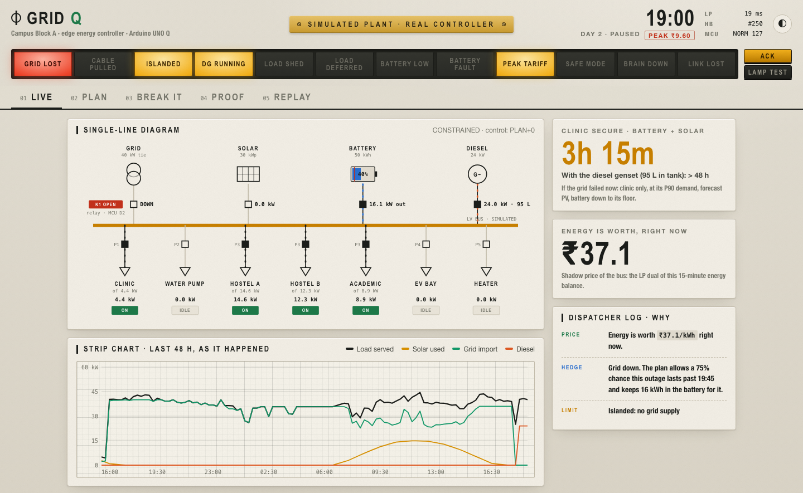
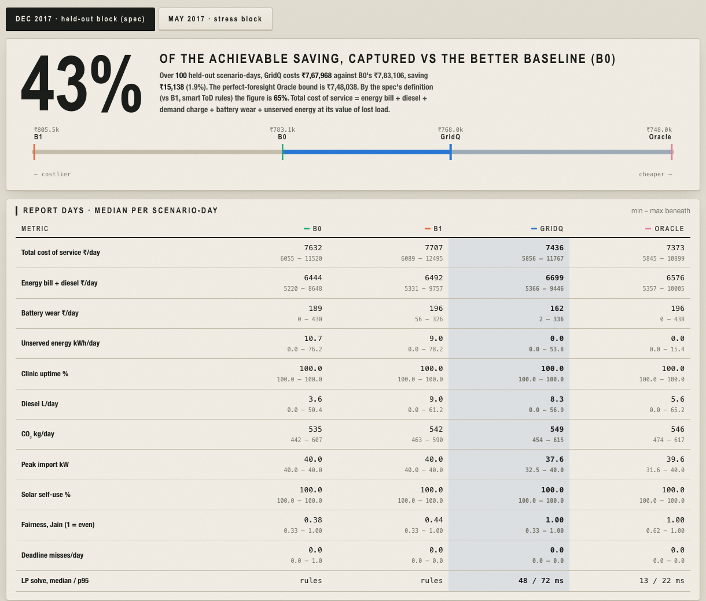
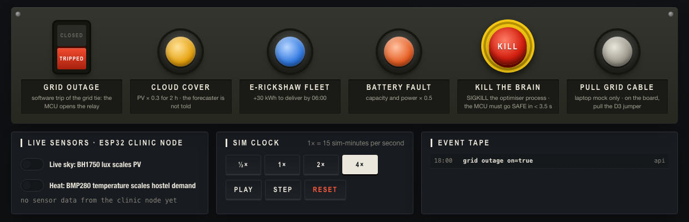
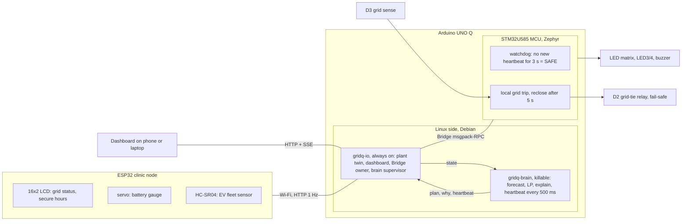
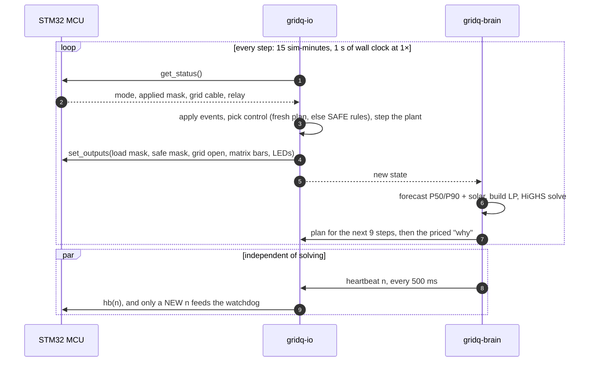
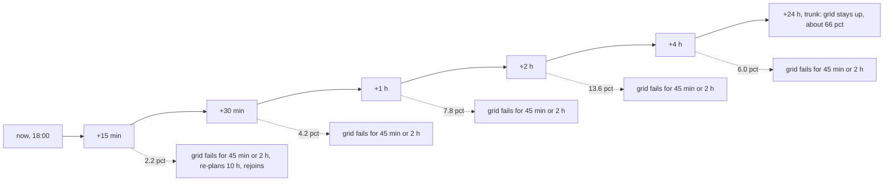
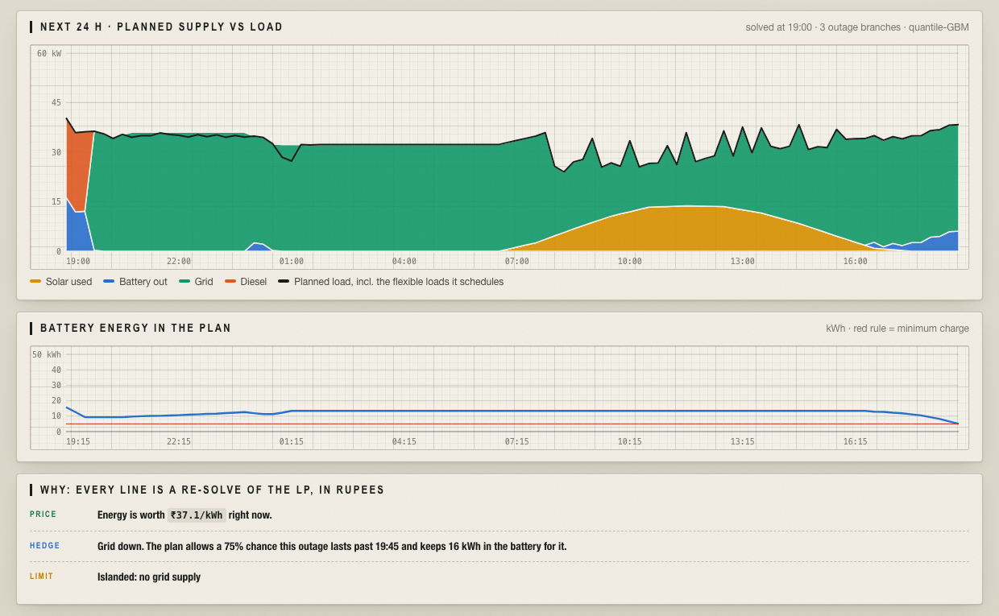
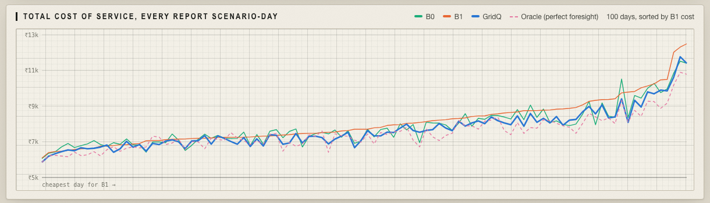
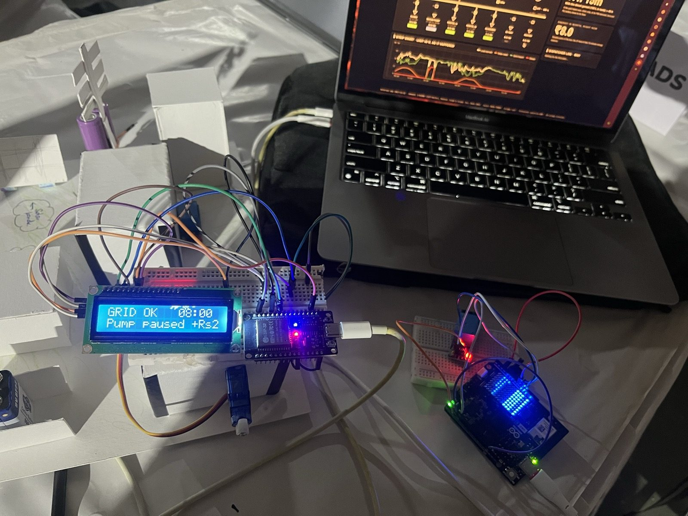

<div align="center">

# GridQ

**An offline energy brain for a campus microgrid that has a clinic on it.**<br>
It forecasts, optimises and explains every 15 minutes on an Arduino UNO Q, and it fails safe when you pull the plug on it.


-2a6fd0)


<sub>Hack-O-Octo 4.0 · PS08 · Energy for the Next Billion</sub>

</div>

<picture>
  <source media="(prefers-color-scheme: dark)" srcset="docs/img/live-dark.png">
  
</picture>

<sub>The live panel at 19:00 on a held-out December day, 45 minutes into a grid outage. Islanded, diesel at 24 kW, battery at 16 kW, **every feeder still on**. The optimiser prices energy at ₹37.1/kWh and plans for a 75% chance the outage runs past 19:45.</sub>

---

## The problem

Hundreds of millions of people get power from grids that fail every day. A campus or a primary health centre with solar, a battery and a diesel genset mostly runs them with rules. *Charge when the sun shines. Discharge in the evening. Start the genset below 20%.* Rules don't see tomorrow's demand. They don't know an outage at 19:00 costs more than one at 03:00. They can't weigh diesel at ₹27/kWh against cutting a hostel. And when the controller crashes, nobody is in charge.

**GridQ replaces the rules with an optimiser that can explain itself.** It's small enough to run offline on a credit-card-sized board, and it's wrapped in a microcontroller safety layer that doesn't trust it.

## Results at a glance

Held-out real campus days (I-BLEND, IIIT-Delhi, December 2017) the forecaster never saw. Each day is run with 5 random outage patterns (about 1.5 outages per day), giving **100 report scenario-days**. Every controller sees the same days and the same outages.

| | Total cost of service | Unserved energy | Clinic uptime | Fairness (Jain, median) |
|---|---:|---:|---:|---:|
| **B0** · inverter default | ₹7,83,106 | 1,489 kWh | 100% | 0.38 |
| **B1** · hand-tuned time-of-day rules | ₹8,05,486 | 1,335 kWh | 100% | 0.44 |
| **GridQ** | **₹7,67,968** | **317 kWh** | **100%** | **1.00** |
| Oracle · perfect foresight (the bound) | ₹7,48,038 | 17 kWh | 100% | 1.00 |

- **43% of the achievable saving captured** against the stronger baseline (B0), saving ₹15,138. Against B1, the spec's definition, it's **65%**. *Captured = (baseline − GridQ) / (baseline − Oracle).*
- **79% less unserved energy** than B0, with cuts spread evenly across feeders instead of always hitting the same hostel.
- **Summer stress block** (May 2017, when the 40 kW grid cap binds): GridQ captures **93%** of the achievable saving vs the best baseline. Unserved energy falls from 30,483 to 9,068 kWh.
- **Median solve: 48 ms** on an M1 laptop and about 0.1 s on the UNO Q, for a decision made every 15 minutes.

> [!NOTE]
> **Total cost of service** = energy bill + diesel + demand charge + battery wear + value of lost load × unserved energy + penalty × missed EV/pump/heater energy. We charge every controller for the energy it buys *and* the energy it fails to deliver. GridQ's *energy bill + diesel* alone is actually higher than B0's (₹6.83L vs ₹6.45L), because it buys energy to serve load that B0 just drops. See [the honesty ledger](#honesty-ledger).

<p align="center"></p>

## Break it: the 60-second demo

Every button on the dashboard's *Break it* console is a real fault injection. The first two are physical.

<!-- DEMO GIF: record pulling the D3 jumper and pressing KILL, save as docs/img/demo.gif, then uncomment:
<p align="center"></p>
-->

| You do | GridQ does | How fast |
|---|---|---|
| **Pull the D3 jumper** (grid lost) | The **MCU opens the grid tie by itself**: the relay clicks, the buzzer beeps, LED4 turns blue. The optimiser re-plans islanded (battery + diesel, trim by price, clinic last). | 50 ms debounce with no Linux in the path. Recloses after 5 s of stable grid. |
| **Press KILL** (SIGKILL the optimiser) | Heartbeats stop, so the **MCU goes SAFE**: clinic + pump only, LED3 red, "SAFE" on the LED matrix, a long tone. io respawns the brain, and the first new heartbeat returns NORMAL with a double chirp. | SAFE in < 3.5 s. Back to NORMAL in about 25 s. |
| **Cloud cover** | Solar × 0.3 for 2 h. The forecaster is **not told**; it notices from measurements. | Within about 1 sim-hour |
| **E-rickshaw fleet** (or a hand under the ultrasonic sensor) | +30 kWh due by 06:00. The LP finds the cheapest slots: *"EV paused. Running it now costs ₹17 more. Deadline still met."* | Next step |
| **Battery fault** | Capacity and power × 0.5; the plan adapts. | Next step |
| **Stop the app / lose Wi-Fi** | The ESP32 clinic display shows `LINK LOST`, then rejoins Wi-Fi on its own. | ≤ 6 s |

<p align="center"></p>

## How it works

### Architecture

One rule organises the system: **whatever can crash is not in charge of safety.**



- **The heartbeat comes only from the brain.** io forwards it as-is and never invents one, so killing the optimiser starves the MCU's watchdog for real. The MCU only counts a *new* value, so a hung process repeating itself doesn't keep it alive.
- **The grid trip is local.** D3 is read on the MCU and the relay is driven by the MCU. Linux can freeze and the site still islands safely.
- **The relay is fail-safe.** It's driven open-drain, so an unpowered or resetting MCU releases it and the site stays on the grid.
- **Fully offline.** Models are trained on a laptop and shipped as files, fonts are vendored, and the ESP32 finds the board on the local network (configured IP → mDNS → /24 sweep).

### One control step



A failed solve reuses the last good plan for up to 2 hours (8 steps), then falls back to the SAFE rule controller. The plant never waits on the optimiser.

## The optimiser

### A merit order that can see the future

Every option has a price in rupees per kWh. The LP chooses the cheapest 24-hour plan that respects the physics, and the battery lets it move energy through time.

| Option | ₹/kWh | |
|---|---:|---|
| Solar | 0 | Curtailing it costs ₹1, so it's used whenever possible |
| Grid, solar hours / normal / evening peak | 6.8 / 8.0 / 9.6 | India time-of-day tariff, 40 kW cap, ₹15/kW demand charge on the day's peak |
| Battery throughput | 2.3 + losses | Wear on every kWh in and out; 95% efficiency each way |
| Diesel genset | 27 | 0.30 L/kWh × ₹90/L; 24 kW; 100 L tank refilled daily |
| EV / pump / heater energy missed at its deadline | 60 / 150 / 30 | Pausing them *before* the deadline is free, which is where flexibility comes from |
| Trim a hostel or the academic block | 40 × burden | Value of lost load; the burden grows with hours already shed today (fairness) |
| Trim the clinic | 500 | Last resort, after everything else |

### The linear program

Every step, over a 24 h horizon of 96 quarter-hours ($\Delta t = 0.25$ h), GridQ solves:

$$
\min \sum_{t=0}^{95} w_t \Delta t \Big[ c_t  g_t + \kappa (b^+_t + b^-_t) + c_{\mathrm{dg}}  d_t + \epsilon  u_t + \sum_{\ell} \mathrm{VoLL}_\ell  \beta_\ell  x_{\ell,t} \Big] \quad + \quad \pi \sum_{\mathrm{day}} P_{\mathrm{day}} \quad + \quad \sum_s \sigma_s  m_s \quad - \quad V  E_{T}
$$

$$
\begin{aligned}
& \mathrm{PV}_t - u_t + g_t + d_t + b^-_t - b^+_t  =  \textstyle\sum_\ell \big(D_{\ell,t} - x_{\ell,t}\big) + \sum_s p_{s,t} && \text{energy balance (its dual is the price of energy now)} \\
& E_{t+1} = E_t + \eta \Delta t  b^+_t - \Delta t  b^-_t / \eta && \text{battery, } \eta = 0.95,\ 5 \le E \le 47.5\text{ kWh} \\
& 0 \le g_t \le G_t, \qquad g_t \le P_{\mathrm{day}(t)} && G_t = 40\text{ kW, or } 0 \text{ when islanded} \\
& \textstyle\sum_{t \in \mathrm{day}} 0.30 \Delta t  d_t \le \mathrm{tank}_{\mathrm{day}} && \text{fuel} \\
& \textstyle\sum_t \Delta t  p_{s,t} + m_s \ge R_s && \text{EV, pump, heater deadlines}
\end{aligned}
$$

Here $g$ is grid import, $b^\pm$ is battery charge/discharge, $d$ is diesel, $u$ is curtailed solar, $x_{\ell,t}$ is load trimmed per feeder, $p_{s,t}$ is power to each flexible session, and $m_s$ is energy missed at a deadline. $V$ = ₹8/kWh is the terminal value of stored energy, so the plan doesn't drain the battery just because the horizon ends.

**Size:** 5,837 variables and 1,557 constraints with the outage tree. **Solver:** HiGHS via `scipy.optimize.linprog`. We build the sparse matrices directly, without a modelling layer, because CVXPY's setup alone would take longer than the solve.

**Why a pure LP:**
- **Duals for free.** That's how the dashboard can say *"energy is worth ₹37.1/kWh right now"*.
- **A proven optimum in milliseconds** on an ARM board.
- **No binaries needed.** Charging and discharging at once would burn ₹4.6/kWh of wear against a ₹1 curtailment penalty, so the optimum never does it.

### MPC with an outage fan tree

**Model predictive control:** plan 24 h, apply 15 minutes, measure, re-plan. A forecast error costs at most one step.

A plain MPC assumes the grid stays up, so it drains the battery at the evening peak, exactly when an outage hurts most. GridQ's LP solves a **trunk** (the grid stays up) together with **10 branches** (the grid fails at +15 min, 30 min, 1 h, 2 h or 4 h, for 45 min or 2 h). Each branch is weighted by the probability that the first outage starts in its window:



<sub>Weights from a real 18:00 solve.</sub>

- **Non-anticipativity.** A branch must share every decision with the trunk until its outage starts, because the controller can't know it's coming. So the action applied *now* is a hedge that works in every branch.
- **Weights come from outage statistics, never the realised schedule.** A real site would estimate the same numbers from its outage log.
- **During an outage the tree flips.** The trunk assumes the optimistic restoration quartile, and three branches stay dark longer.
- **At the rejoin**, the battery difference from the trunk is valued at ₹8/kWh, so the tree prices "an outage left us with less battery".

That's what made the optimiser win. Every variant was chosen on **tune days 1–10 only**:

| Variant (tune days) | Captured |
|---|---:|
| Spec: deterministic MPC + fixed P90 clinic reserve | −38.6% |
| Deterministic, no reserve | −34.8% |
| Fan tree + P90 reserve | 44.8% |
| Fan tree | 65.3% |
| Fan tree, min-max fairness | 64.5% |
| **Fan tree + terminal value ₹8 (shipped)** | **67.5%** |

Without the tree, the optimiser lost to the rule controllers. With it, it beats them.

### Explanations are re-solves, not prose

Every line in the dispatcher log and on the clinic LCD is computed from the LP:

| Kind | How | Example from a live run |
|---|---|---|
| Price | Dual of this step's energy balance | *Energy is worth ₹37.1/kWh right now.* |
| Hedge | Sum of branch weights | *Grid down. The plan allows a 75% chance this outage lasts past 19:45 and keeps 16 kWh in the battery for it.* |
| Deferral | Re-solve with the load forced on | *EV paused. Running it now costs ₹17 more. Deadline still met.* |
| Battery held | Re-solve with 10 kW forced discharge | *Battery holding 30 kWh. Discharging 10 kW now would cost ₹14 more over the plan.* |
| Clinic secure | Clinic-only P90 demand on forecast solar + battery (+ diesel) | `SECURE 7h30m` · `+DIESEL >48h` |

Why it doesn't buy at ₹6.8 and discharge at the ₹9.6 peak: by the time it's delivered, that kWh costs $6.8/0.95^2 + 2.3 (1/0.95^2 + 1) \approx 12.4$ ₹/kWh, which is more than 9.6. **Grid arbitrage never pays at these prices, and the LP knows it.** B1 does it anyway and pays in wear. The battery earns its keep from solar shifting, the 40 kW cap, the demand charge and, above all, outages.

### The forecaster

Gradient-boosted quantile trees (scikit-learn `HistGradientBoostingRegressor`), one P50 and one P90 model per feeder. They predict all 95 horizons in one batched call.

- **17 causal features:** time of day, weekday, the published IIIT-D working-day calendar, the same time yesterday and last week, recent levels, and ratios. A test checks there's no future leakage.
- **Residual over a naive baseline:** with no signal, it reverts to "same time, last day of the same type".
- **Split-conformal P90:** shifted on the last 45 training days so it covers ~90% by construction.
- **Solar:** clear-sky × an EWMA of measured clearness.

| Held-out December block | GridQ | Naive |
|---|---:|---:|
| Demand P50 MAE | 1.127 kW | 1.162 kW |
| Demand P90 coverage (target 90%) | 90.0% | — |
| Solar MAE vs persistence | 0.255 kW | 0.482 kW |

December campus load is very regular, so the demand model only edges out naive there. In the summer block it's 1.52 vs 2.05 kW.

<p align="center"></p>

## How we kept the proof honest

- **Held-out, chronological.** The forecaster for each block trains only on data before it. Days 1–10 tune, days 11–30 report. The summer block is a second, independent fold.
- **Stronger baselines, not weaker.** B0 recharges from the grid like a real backup inverter. B1 refills in cheap hours and discharges to respect the 40 kW cap. Without that, B0's battery would sit empty after the first outage, which would be a strawman.
- **Continuous 30-day runs.** The battery carries over between days and is settled once at the end, at the same price for every controller. Independent days would reward draining the battery before midnight.
- **Same prices in the plan and in the scorecard.** The metric uses the same VoLL and penalties the optimiser uses, and it's broken out per term on the Proof tab.
- **Every design change has a before/after**, recorded in [DECISIONS.md](DECISIONS.md) along with the reason.

<p align="center"></p>

### Honesty ledger

| Real | Simulated |
|---|---|
| Forecaster, optimiser, explanations | Solar array (30 kWp), battery (50 kWh / 25 kW), diesel genset (24 kW) |
| MCU safety supervisor, relay, LED matrix, buzzer | The feeders' breakers (the relay contacts carry no load in the demo) |
| ESP32 clinic node: LCD, servo gauge, ultrasonic EV sensor | Clinic demand: no public clinic data exists, so it's modelled and labelled |
| Campus demand (I-BLEND) and solar (NASA POWER), same place and same days | Outage pattern: Poisson, 1.5/day, 20–180 min |

What we don't hide:
- **GridQ's energy bill + diesel is higher than B0's.** It wins on total cost because it serves 1,172 kWh more load.
- **Oracle ≤ GridQ holds in total, not on every single day** (29 of 100 days are exceptions). Runs are continuous, so each day inherits a different battery.
- **Summer clinic uptime is 99.95%**, not 100%, in the worst cap-bound outages. The baselines reach 100% there by shedding far more of everything else.
- **The plant is a model.** The dashboard says so on its nameplate: *SIMULATED PLANT · REAL CONTROLLER*.

## Hardware

<!-- HARDWARE PHOTO: save a photo of the rig as docs/img/rig.jpg, then uncomment:
<p align="center"></p>
-->

| Part | Role |
|---|---|
| **Arduino UNO Q** (Qualcomm QRB2210 Linux + STM32U585 MCU) | Runs everything: Linux runs the optimiser, the MCU runs safety |
| 5 V relay module | Grid-tie switch (wired COM–NC: de-energised = on grid) |
| Jumper wire on D3 → GND | The "grid cable": pull it to cause an outage |
| Active buzzer | Alarms: relay change, SAFE entry and exit |
| ESP32 DevKit | Clinic node, on Wi-Fi only (no shared wires with the UNO Q) |
| 16×2 I2C LCD · SG90 servo · HC-SR04 | Clinic display · battery gauge · EV fleet arrival |

| UNO Q pin | | ESP32 pin | |
|---|---|---|---|
| `D2` | relay IN (open-drain) | `GPIO21` / `GPIO22` | I2C SDA / SCL (LCD) |
| `D3` | grid sense, `INPUT_PULLUP` | `GPIO18` | servo signal |
| `D4` | buzzer + | `GPIO5` | HC-SR04 TRIG |
| built-in | 8×13 LED matrix, LED3 (mode), LED4 (grid) | `GPIO19` | HC-SR04 ECHO **through a 1k/2k divider** |

Why the relay is open-drain: a 3.3 V "HIGH" can't release a 5 V active-low relay module (1.7 V stays across its opto-LED). D2 is 5 V tolerant, so the MCU floats it for OFF and sinks it for ON. See [`config/hardware.yaml`](config/hardware.yaml) for every verified board fact.

## Run it

### On a laptop (mock MCU, about 2 minutes)

The data and trained models are in the repo, so nothing needs downloading.

```bash
git clone https://github.com/Arshgill01/GridQ.git && cd GridQ
uv venv --python 3.13 .venv && uv pip install --python .venv/bin/python -r requirements.txt pytest httpx requests
GRIDQ_MOCK_BRIDGE=1 .venv/bin/python -m gridq.io.app        # open http://localhost:8000
```

The mock Bridge runs the same state machine as the sketch (3 s watchdog, 5 s reclose), and adds a *Pull grid cable* button.

```bash
.venv/bin/python -m pytest -q                                # 22 tests
.venv/bin/python -m gridq.bench.run_days                     # winter benchmark, about 3.5 min on an M1
.venv/bin/python -m gridq.bench.run_days --fold summer       # summer stress block
```

### On the Arduino UNO Q

```bash
tools/deploy_unoq.sh                                                   # pushes the app, flashes the sketch
adb shell arduino-app-cli app start /home/arduino/ArduinoApps/gridq
adb shell arduino-app-cli properties set default user:gridq            # start on every boot
```

Then open `http://<board-ip>:8000` from any phone on the same Wi-Fi. [RUNBOOK.md](RUNBOOK.md) has the hardware acceptance test (`tools/hw_test.py`), the ESP32 setup, and troubleshooting.

### ESP32 clinic node

Copy `esp32/clinic_node/secrets.h.example` to `secrets.h` and set the Wi-Fi details. Then:

```bash
arduino-cli compile --fqbn esp32:esp32:esp32 esp32/clinic_node
arduino-cli upload -p <port> --fqbn esp32:esp32:esp32:UploadSpeed=115200 esp32/clinic_node
```

It finds the UNO Q on its own: configured IP first, then mDNS, then a sweep of the local /24.

## Repository map

| Path | What's there |
|---|---|
| [`gridq/control/`](gridq/control) | `lp.py` the sparse LP and fan tree · `mpc.py` MPC + Oracle · `explain.py` duals and counterfactual re-solves · B0, B1 and SAFE controllers |
| [`gridq/forecast/`](gridq/forecast) | Features, quantile GBM training with conformal P90, solar forecast |
| [`gridq/plant/`](gridq/plant) | The plant twin, real-data profiles, outage generator, events |
| [`gridq/io/`](gridq/io) | FastAPI server, Bridge client (real msgpack-RPC + mock), brain supervisor, replay |
| [`gridq/brain/`](gridq/brain) | The killable optimiser process and its heartbeat thread |
| [`gridq/bench/`](gridq/bench) | Benchmark runner, metrics, replay against B0 |
| [`sketch/`](sketch) | MCU supervisor: watchdog, local trip, relay, matrix, buzzer |
| [`esp32/clinic_node/`](esp32/clinic_node) | Clinic display node |
| [`web/`](web) | Dashboard: single-line diagram, annunciator, Break-it console, Proof, Replay |
| [`config/`](config) | `params.yaml` (plant, prices, controller knobs) · `hardware.yaml` (pins, board facts) |
| [`tools/`](tools) | Data prep, NASA POWER fetch, tuning, deploy, hardware test |
| [`DECISIONS.md`](DECISIONS.md) | Every change from the spec, with the measured before/after |

## Design decisions

The short version of [DECISIONS.md](DECISIONS.md):

1. **Total cost of service as the headline**, not the energy bill, which rewards not serving load.
2. **Direct sparse LP on HiGHS**, not CVXPY: one fewer heavy dependency on the board, and 28,800 benchmark solves in minutes.
3. **The outage fan tree** instead of a fixed clinic reserve: −38.6% → 65.3% captured on tune days.
4. **Continuous runs, with battery settled once**, so nobody is rewarded for draining before midnight.
5. **Realistic, stronger baselines.**
6. **Direct multi-horizon quantile GBM with conformal P90.**
7. **Weather from IIIT-Delhi**, where the demand data comes from (the spec had Chandigarh).
8. **Daily diesel refill.** Without it every controller ran dry by day 6, and the comparison measured fuel logistics instead of control.
9. **Single-threaded OpenMP:** forecasts went from 700 ms to 14 ms on the 4-core board.

## Data and references

- **Demand:** I-BLEND, IIIT-Delhi campus electricity at 1-minute resolution. Rashid, Singh & Singh, *Scientific Data* 6, 2019. Hostel and academic feeders, scaled to our block's size with their real shape.
- **Solar:** NASA POWER hourly irradiance for IIIT-Delhi (28.5459 N, 77.2732 E), the same dates.
- **Solver:** HiGHS, by Huangfu & Hall, via SciPy.
- **Tariff:** India time-of-day structure, cheaper in solar hours and dearer at the evening peak.
